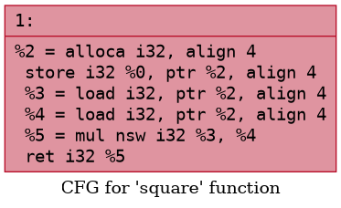
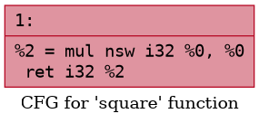
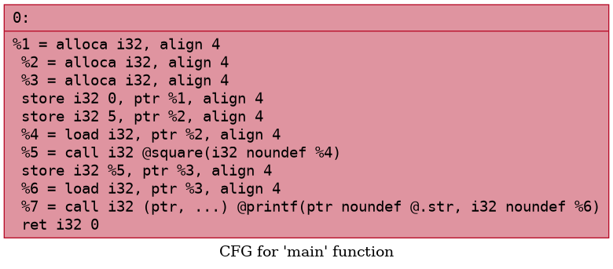
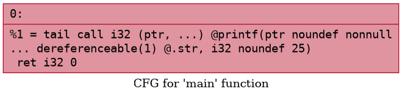
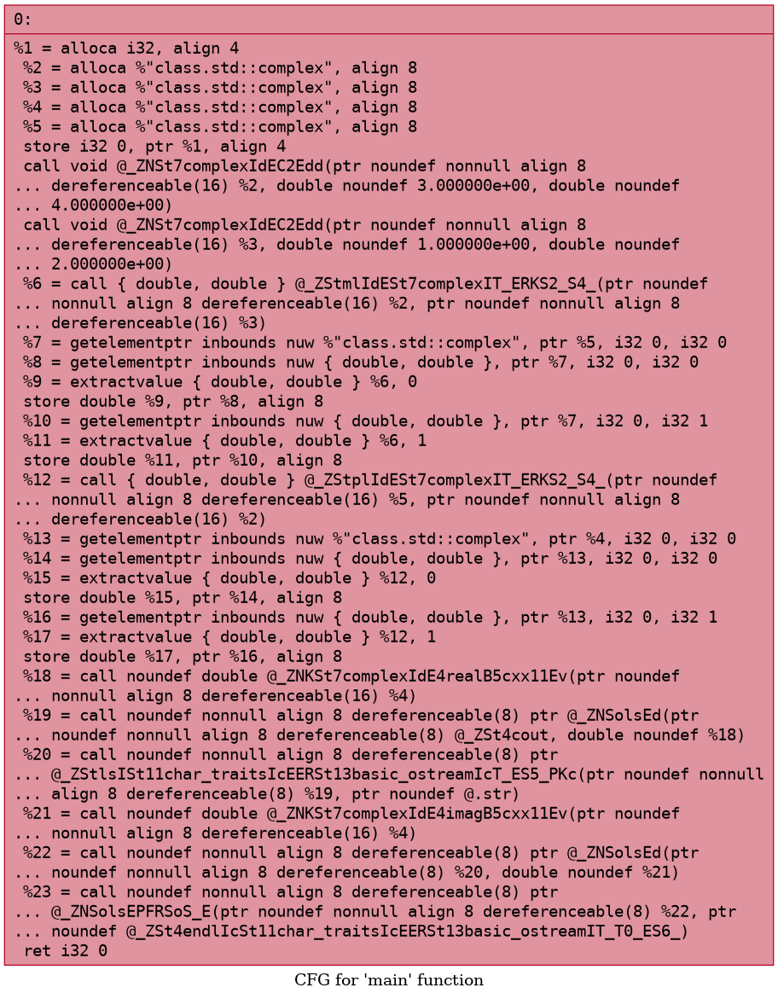
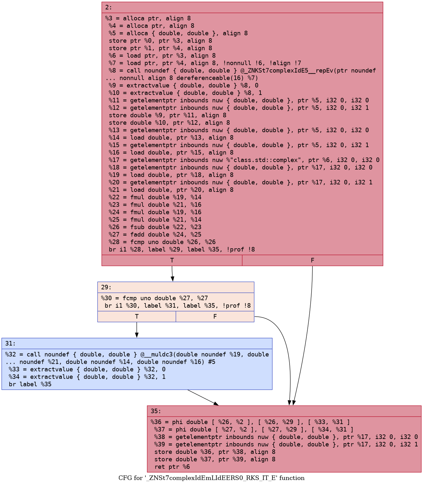
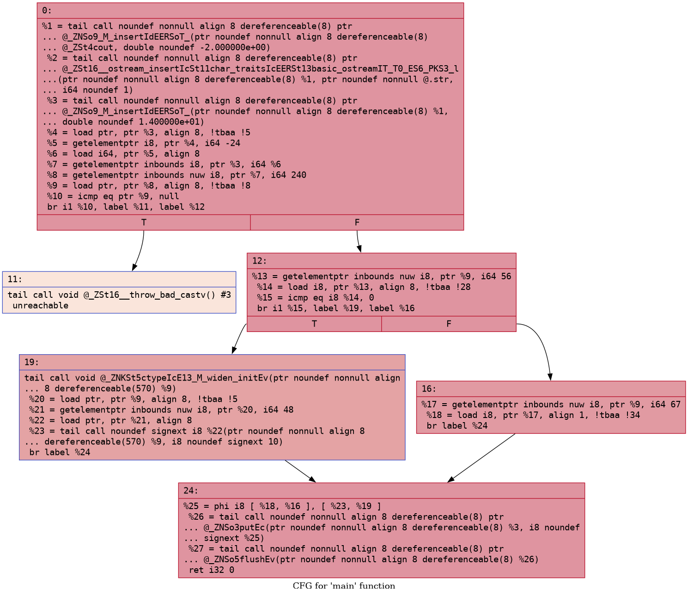
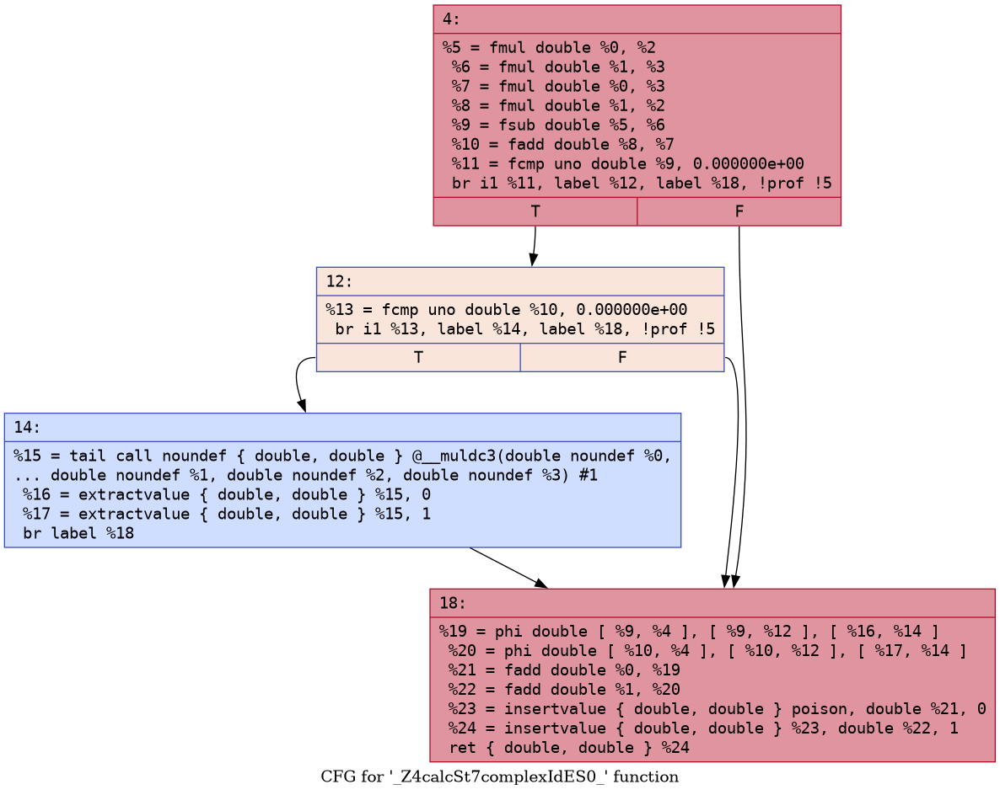
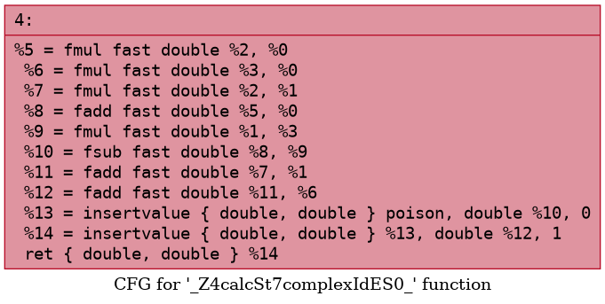

# Анализ и преобразование кода с использованием Clang и LLVM — лабораторная работа №7

Дисциплина «Теория формальных языков и компиляторов».

**Автор:** Лузянин З., группа АП-326

## Постановка задачи

### Цель работы
Познакомиться с инструментарием Clang и LLVM, освоить получение абстрактного синтаксического дерева (AST) и промежуточного представления (LLVM IR) для кода на C/C++, научиться применять базовые оптимизации, строить графы потока управления (CFG), а также анализировать влияние оптимизаций на различные синтаксические конструкции языка.

### Общее задание
1. Установить Clang, LLVM, opt и Graphviz.
2. Сгенерировать AST для C-файла.
3. Получить LLVM IR без оптимизаций (`-O0`) и с оптимизациями (`-O2`).
4. Применить оптимизации с помощью `opt` и флагов Clang, сравнить изменения.
5. Построить CFG для функций программы.
6. Выполнить индивидуальное задание.
7. Ответить на контрольные вопросы.

### Индивидуальное задание — вариант 2.1 «Комплексные числа»
Пример кода ([individual/complex.cpp](individual/complex.cpp)):
```cpp
#include <iostream>
#include <complex>

int main() {
    std::complex<double> z1(3.0, 4.0);
    std::complex<double> z2(1.0, 2.0);
    auto z3 = z1 * z2 + z1;
    std::cout << z3.real() << " " << z3.imag() << std::endl;
    return 0;
}
```
Задания:
1. Построить AST и LLVM IR (без оптимизаций).
2. Применить оптимизации `-O1`, `-O2`, `-O3` и сравнить полученный IR.
3. Исследовать, встраиваются ли операторы `*` и `+` для комплексных чисел.
4. Построить CFG для функции `main` до и после `-O2`.
5. Сделать выводы о том, как компилятор обрабатывает пользовательские операторы.

### Структура репозитория
| Путь | Содержимое |
|---|---|
| [run.sh](run.sh) | скрипт, который выполняет все команды работы и выводит статистику по IR |
| [general/](general) | общая часть: `main.c`, AST, IR `-O0`/`-O2`, результаты `opt`, CFG |
| [individual/](individual) | индивидуальная часть: `complex.cpp`, `calc.cpp`, AST, IR `-O0`…`-O3`, CFG |

Все файлы `.ll`, `.txt`, `.dot`, `.png` в папках получены скриптом `run.sh`, их можно пересоздать командой `bash run.sh`.

## Общее задание

### Установка среды
Работа выполнялась в Ubuntu 26.04 (WSL 2), версия компилятора — Ubuntu clang 21.1.8.

```bash
sudo apt update && sudo apt install -y clang llvm graphviz
```
+ `clang` — фронтенд компилятора C/C++: препроцессор, лексический, синтаксический и семантический анализ, построение AST и генерация LLVM IR;
+ `llvm` — библиотека и утилиты для работы с IR, в том числе `opt` (оптимизатор) и `llc`;
+ `graphviz` — утилита `dot` для перевода графов из `.dot` в `.png`.


### Исходный код
[general/main.c](general/main.c):
```c
#include <stdio.h>
int square(int x) {
    return x * x;
}
int main() {
    int a = 5;
    int b = square(a);
    printf("%d\n", b);
    return 0;
}
```

### Работа с AST
```bash
clang -Xclang -ast-dump -fsyntax-only main.c
```
Полный вывод — [general/main_ast.txt](general/main_ast.txt) (925 строк: большая часть — объявления из `stdio.h`). Фрагмент для функций программы (адреса узлов убраны):
```
|-FunctionDecl <main.c:2:1, line:4:1> line:2:5 used square 'int (int)'
| |-ParmVarDecl <col:12, col:16> col:16 used x 'int'
| `-CompoundStmt <col:19, line:4:1>
|   `-ReturnStmt <line:3:5, col:16>
|     `-BinaryOperator <col:12, col:16> 'int' '*'
|       |-ImplicitCastExpr <col:12> 'int' <LValueToRValue>
|       | `-DeclRefExpr <col:12> 'int' lvalue ParmVar 'x' 'int'
|       `-ImplicitCastExpr <col:16> 'int' <LValueToRValue>
|         `-DeclRefExpr <col:16> 'int' lvalue ParmVar 'x' 'int'
`-FunctionDecl <line:5:1, line:10:1> line:5:5 main 'int ()'
  `-CompoundStmt <col:12, line:10:1>
    |-DeclStmt <line:6:5, col:14>
    | `-VarDecl <col:5, col:13> col:9 used a 'int' cinit
    |   `-IntegerLiteral <col:13> 'int' 5
    |-DeclStmt <line:7:5, col:22>
    | `-VarDecl <col:5, col:21> col:9 used b 'int' cinit
    |   `-CallExpr <col:13, col:21> 'int'
    |     |-ImplicitCastExpr <col:13> 'int (*)(int)' <FunctionToPointerDecay>
    |     | `-DeclRefExpr <col:13> 'int (int)' Function 'square' 'int (int)'
    |     `-ImplicitCastExpr <col:20> 'int' <LValueToRValue>
    |       `-DeclRefExpr <col:20> 'int' lvalue Var 'a' 'int'
    |-CallExpr <line:8:5, col:21> 'int'
    | ...
    `-ReturnStmt <line:9:5, col:12>
      `-IntegerLiteral <col:12> 'int' 0
```
+ функция `square` — узел `FunctionDecl` с параметром `ParmVarDecl x` и телом `ReturnStmt → BinaryOperator '*'`;
+ `main` содержит два объявления `VarDecl` (`a` с `IntegerLiteral 5`, `b` с вызовом `CallExpr square(a)`), вызов `printf` и `ReturnStmt`;
+ AST хранит всё, что есть в исходном тексте: позиции, типы, неявные преобразования (`ImplicitCastExpr <LValueToRValue>` — чтение значения переменной, `<FunctionToPointerDecay>` — имя функции превращается в указатель при вызове).

### Генерация LLVM IR
```bash
clang -S -emit-llvm main.c -o main.ll
clang -O0 -S -emit-llvm main.c -o main_O0.ll
clang -O2 -S -emit-llvm main.c -o main_O2.ll
```
IR без оптимизаций ([general/main_O0.ll](general/main_O0.ll), по умолчанию clang использует `-O0`, поэтому `main.ll` совпадает с `main_O0.ll`):
```llvm
; Function Attrs: noinline nounwind optnone uwtable
define dso_local i32 @square(i32 noundef %0) #0 {
  %2 = alloca i32, align 4
  store i32 %0, ptr %2, align 4
  %3 = load i32, ptr %2, align 4
  %4 = load i32, ptr %2, align 4
  %5 = mul nsw i32 %3, %4
  ret i32 %5
}

define dso_local i32 @main() #0 {
  %1 = alloca i32, align 4
  %2 = alloca i32, align 4
  %3 = alloca i32, align 4
  store i32 0, ptr %1, align 4
  store i32 5, ptr %2, align 4
  %4 = load i32, ptr %2, align 4
  %5 = call i32 @square(i32 noundef %4)
  store i32 %5, ptr %3, align 4
  %6 = load i32, ptr %3, align 4
  %7 = call i32 (ptr, ...) @printf(ptr noundef @.str, i32 noundef %6)
  ret i32 0
}
```
+ каждая переменная (`a`, `b`, копия параметра `x`, место под код возврата) размещена в памяти через `alloca`;
+ каждое чтение — `load`, каждая запись — `store`, даже если значение уже есть в регистре;
+ `square` вызывается через `call`, функции помечены `noinline optnone` — оптимизатор не имеет права их менять.

IR с `-O2` ([general/main_O2.ll](general/main_O2.ll)):
```llvm
define dso_local i32 @square(i32 noundef %0) local_unnamed_addr #0 {
  %2 = mul nsw i32 %0, %0
  ret i32 %2
}

define dso_local noundef i32 @main() local_unnamed_addr #1 {
  %1 = tail call i32 (ptr, ...) @printf(ptr noundef nonnull dereferenceable(1) @.str, i32 noundef 25)
  ret i32 0
}
```

### Оптимизация IR
Сравнение `-O0` и `-O2` (`diff main_O0.ll main_O2.ll`, полный вывод — [general/main_diff.txt](general/main_diff.txt)):

| Файл | Функций | `alloca` | `load` | `store` | `call` | Строк |
|---|---|---|---|---|---|---|
| main_O0.ll | 2 | 4 | 4 | 4 | 2 | 46 |
| main_O2.ll | 2 | 0 | 0 | 0 | 1 | 34 |

Что сделал `-O2`:
+ **SROA / mem2reg** — все `alloca`, `load`, `store` удалены, значения живут в виртуальных регистрах, код в SSA-форме (`%2 = mul nsw i32 %0, %0`);
+ **inline** — вызов `square(a)` встроен в `main`;
+ **константное распространение и свёртка** (InstCombine, SCCP) — после встраивания `5 * 5` вычислено при компиляции, в `printf` передаётся готовое `25`;
+ **tail call** — вызов `printf` помечен как хвостовой;
+ функция `square` осталась в модуле, хотя из `main` она больше не вызывается: у неё внешняя связь (`dso_local`, не `static`), и её может вызвать другой файл программы. Если объявить её `static`, `-O2` удалит её полностью.

Оптимизации через `opt`. Файл, собранный с `-O0`, для `opt` не подходит: clang ставит функциям атрибут `optnone`, и `opt` их пропускает. Поэтому использовались два способа:
```bash
clang -O0 -Xclang -disable-O0-optnone -S -emit-llvm main.c -o main_O0_noopt.ll
opt -passes=mem2reg -S main_O0_noopt.ll -o main_mem2reg.ll
opt -O2 -S main_O0_noopt.ll -o main_opt_O2_noinline.ll

clang -O2 -Xclang -disable-llvm-passes -S -emit-llvm main.c -o main_raw.ll
opt -O2 -S main_raw.ll -o main_opt_O2.ll
```
+ только `mem2reg` ([general/main_mem2reg.ll](general/main_mem2reg.ll)) — переменные переведены в регистры, но вызов остался:
  ```llvm
  define dso_local i32 @square(i32 noundef %0) #0 {
    %2 = mul nsw i32 %0, %0
    ret i32 %2
  }
  define dso_local i32 @main() #0 {
    %1 = call i32 @square(i32 noundef 5)
    %2 = call i32 (ptr, ...) @printf(ptr noundef @.str, i32 noundef %1)
    ret i32 0
  }
  ```
+ `opt -O2` для IR из `-O0` ([general/main_opt_O2_noinline.ll](general/main_opt_O2_noinline.ll)) — `square` **не встроилась**: атрибут `noinline`, который clang ставит при `-O0`, запрещает встраивание, остаётся `tail call i32 @square(i32 noundef 5)`;
+ `opt -O2` для IR из `-O2 -disable-llvm-passes` ([general/main_opt_O2.ll](general/main_opt_O2.ll)) — фронтенд сгенерировал «сырой» IR без запрещающих атрибутов, и `opt -O2` дал тот же результат, что и `clang -O2`: `printf(..., 25)`.

Вывод: `clang -O2` = генерация IR фронтендом + тот же конвейер проходов, что запускает `opt -O2`; результат зависит от атрибутов, которые фронтенд записал в IR.

### Построение CFG
```bash
opt -passes=dot-cfg -disable-output main_O0.ll
dot -Tpng .square.dot -o cfg.square.png
dot -Tpng .main.dot -o cfg.main.png
```
(В LLVM 21 проход вызывается через `-passes=dot-cfg`, старая форма `opt -dot-cfg` больше не поддерживается.)

| | `-O0` | `-O2` |
|---|---|---|
| `square` |  |  |
| `main` |  |  |

В программе нет ветвлений, поэтому каждая функция — один базовый блок и до, и после оптимизации. Меняется содержимое блоков: при `-O0` в `main` 11 инструкций с `alloca`/`load`/`store` и вызовом `square`, при `-O2` — 2 инструкции. CFG строится отдельно для каждой функции, общего графа всей программы LLVM не строит.


## Индивидуальное задание (вариант 2.1 «Комплексные числа»)

### 1. AST и LLVM IR без оптимизаций
```bash
clang++ -Xclang -ast-dump -fsyntax-only complex.cpp
clang++ -O0 -S -emit-llvm complex.cpp -o complex_O0.ll
```
Полный AST содержит десятки тысяч строк из заголовков `<iostream>` и `<complex>`, поэтому в [individual/complex_ast.txt](individual/complex_ast.txt) сохранена только функция `main`. Строка `auto z3 = z1 * z2 + z1;`:
```
|-DeclStmt <line:7:5, col:27>
| `-VarDecl <col:5, col:25> col:10 used z3 'complex<double>':'std::complex<double>' cinit
|   `-ExprWithCleanups <col:15, col:25> 'complex<double>':'std::complex<double>'
|     `-CXXOperatorCallExpr <col:15, col:25> 'complex<double>':'std::complex<double>' '+' adl
|       |-ImplicitCastExpr <col:23> 'complex<double> (*)(const complex<double> &, const complex<double> &)' <FunctionToPointerDecay>
|       | `-DeclRefExpr <col:23> ... Function 'operator+' 'complex<double> (const complex<double> &, const complex<double> &)'
|       |-MaterializeTemporaryExpr <col:15, col:20> 'const complex<double>':'const std::complex<double>' lvalue
|       | `-ImplicitCastExpr <col:15, col:20> 'const complex<double>' <NoOp>
|       |   `-CXXOperatorCallExpr <col:15, col:20> 'complex<double>':'std::complex<double>' '*' adl
|       |     |-ImplicitCastExpr <col:18> ... <FunctionToPointerDecay>
|       |     | `-DeclRefExpr <col:18> ... Function 'operator*' 'complex<double> (const complex<double> &, const complex<double> &)'
|       |     |-ImplicitCastExpr <col:15> 'const complex<double>' lvalue <NoOp>
|       |     | `-DeclRefExpr <col:15> 'std::complex<double>' lvalue Var 'z1'
|       |     `-ImplicitCastExpr <col:20> 'const complex<double>' lvalue <NoOp>
|       |       `-DeclRefExpr <col:20> 'std::complex<double>' lvalue Var 'z2'
|       `-ImplicitCastExpr <col:25> 'const complex<double>' lvalue <NoOp>
|         `-DeclRefExpr <col:25> 'std::complex<double>' lvalue Var 'z1'
```
+ в отличие от `x * x` для `int` (узел `BinaryOperator`), здесь `*` и `+` — узлы `CXXOperatorCallExpr`, то есть **вызовы функций** `operator*` и `operator+` из `<complex>`, найденные поиском, зависящим от аргументов (`adl`);
+ дерево отражает приоритет: `operator*` — вложенный аргумент `operator+`;
+ результат `z1 * z2` — временный объект (`MaterializeTemporaryExpr`), он передаётся в `operator+` по константной ссылке;
+ `z1` и `z2` создаются конструктором `CXXConstructExpr 'void (double, double)'` с аргументами `FloatingLiteral`;
+ `std::cout << ...` — тоже цепочка `CXXOperatorCallExpr '<<'`, `z3.real()` и `z3.imag()` — `CXXMemberCallExpr`.

IR без оптимизаций ([individual/complex_O0.ll](individual/complex_O0.ll)) — 9 функций. Кроме `main`, из шаблонов `<complex>` сгенерированы (имена после `c++filt`):

| Функция в IR | Что это |
|---|---|
| `_ZNSt7complexIdEC2Edd` | конструктор `complex<double>::complex(double, double)` |
| `_ZStmlIdESt7complexIT_ERKS2_S4_` | `operator*(const complex<double>&, const complex<double>&)` |
| `_ZStplIdESt7complexIT_ERKS2_S4_` | `operator+(const complex<double>&, const complex<double>&)` |
| `_ZNSt7complexIdEmLIdEERS0_RKS_IT_E` | `complex<double>::operator*=(const complex<double>&)` |
| `_ZNSt7complexIdEpLIdEERS0_RKS_IT_E` | `complex<double>::operator+=(const complex<double>&)` |
| `_ZNKSt7complexIdE5__repEv` | `complex<double>::__rep()` — внутреннее значение `_Complex double` |
| `_ZNKSt7complexIdE4realB5cxx11Ev`, `...4imag...` | `real()`, `imag()` |

`main` при `-O0`:
```llvm
  %2 = alloca %"class.std::complex", align 8     ; z1
  %3 = alloca %"class.std::complex", align 8     ; z2
  %4 = alloca %"class.std::complex", align 8     ; z3
  %5 = alloca %"class.std::complex", align 8     ; временный z1 * z2
  call void @_ZNSt7complexIdEC2Edd(ptr %2, double 3.000000e+00, double 4.000000e+00)
  call void @_ZNSt7complexIdEC2Edd(ptr %3, double 1.000000e+00, double 2.000000e+00)
  %6 = call { double, double } @_ZStmlIdESt7complexIT_ERKS2_S4_(ptr %2, ptr %3)   ; z1 * z2
  ...
  %12 = call { double, double } @_ZStplIdESt7complexIT_ERKS2_S4_(ptr %5, ptr %2) ; (z1*z2) + z1
  ...
  %18 = call double @_ZNKSt7complexIdE4realB5cxx11Ev(ptr %4)
  %19 = call ptr @_ZNSolsEd(ptr @_ZSt4cout, double %18)
```
+ комплексное число в IR — структура `%"class.std::complex" = { { double, double } }`, результат оператора возвращается как пара `{ double, double }`;
+ `operator*` копирует левый операнд (`memcpy` 16 байт) и вызывает `operator*=`, `operator+` так же вызывает `operator+=` — это реализация из `<complex>`;
+ `operator*=` содержит само умножение `(a+bi)(c+di) = (ac−bd) + (ad+bc)i` и проверку на NaN с вызовом библиотечной функции `__muldc3`:
  ```llvm
  %22 = fmul double %19, %14        ; a*c
  %23 = fmul double %21, %16        ; b*d
  %24 = fmul double %19, %16        ; a*d
  %25 = fmul double %21, %14        ; b*c
  %26 = fsub double %22, %23        ; re = ac - bd
  %27 = fadd double %24, %25        ; im = ad + bc
  %28 = fcmp uno double %26, %26    ; re — NaN?
  br i1 %28, label %29, label %35
  ...
  %32 = call { double, double } @__muldc3(double %19, double %21, double %14, double %16)
  ```
  По стандарту C (Annex G) при NaN в результате нужно проверить случаи с бесконечностями, поэтому в «медленной» ветке вызывается `__muldc3` из compiler-rt/libgcc.

### 2. Оптимизации -O1, -O2, -O3
```bash
clang++ -O1 -S -emit-llvm complex.cpp -o complex_O1.ll
clang++ -O2 -S -emit-llvm complex.cpp -o complex_O2.ll
clang++ -O3 -S -emit-llvm complex.cpp -o complex_O3.ll
diff complex_O1.ll complex_O2.ll
diff complex_O2.ll complex_O3.ll
```

| Файл | Функций | `alloca` | `load` | `store` | `call` | Строк |
|---|---|---|---|---|---|---|
| complex_O0.ll | 9 | 23 | 27 | 29 | 17 | 271 |
| complex_O1.ll | 1 | 0 | 7 | 0 | 8 | 116 |
| complex_O2.ll | 1 | 0 | 7 | 0 | 8 | 116 |
| complex_O3.ll | 1 | 0 | 7 | 0 | 8 | 116 |

`diff` для `-O1`/`-O2` и `-O2`/`-O3` пустой — IR полностью совпадает. `main` после оптимизации ([individual/complex_O2.ll](individual/complex_O2.ll)):
```llvm
define dso_local noundef i32 @main() local_unnamed_addr #0 {
  %1 = tail call ptr @_ZNSo9_M_insertIdEERSoT_(ptr @_ZSt4cout, double noundef -2.000000e+00)
  %2 = tail call ptr @_ZSt16__ostream_insertIcSt11char_traitsIcEERSt13basic_ostreamIT_T0_ES6_PKS3_l(ptr %1, ptr @.str, i64 1)
  %3 = tail call ptr @_ZNSo9_M_insertIdEERSoT_(ptr %1, double noundef 1.400000e+01)
  ...   ; встроенный std::endl: widen('\n'), put, flush
  ret i32 0
}
```
+ от комплексных чисел не осталось ничего: ни `alloca`, ни конструкторов, ни операторов. `(3+4i)(1+2i) + (3+4i) = (−5+10i) + (3+4i) = −2+14i` вычислено при компиляции, в `cout` передаются готовые константы `-2.0` и `14.0`. Программа выводит `-2 14` ([individual/complex_output.txt](individual/complex_output.txt));
+ проверка на NaN и вызов `__muldc3` тоже исчезли: при известных операндах результат не NaN, и ветка оказалась недостижимой;
+ оставшиеся 7 `load` и ветвления — это встроенный `std::endl` (получение `ctype<char>` из потока, `widen('\n')`, `put`, `flush`), к комплексным числам они не относятся;
+ одинаковый результат `-O1`, `-O2`, `-O3` объясняется тем, что вся работа сделана уже на `-O1`: встраивание, SROA и свёртка констант входят в `-O1`. `-O2`/`-O3` добавляют векторизацию, более агрессивное встраивание и развёртку циклов, но здесь нет ни циклов, ни невстроенных вызовов.

Чтобы проверить уровни на коде, где значения неизвестны при компиляции, добавлен [individual/calc.cpp](individual/calc.cpp):
```cpp
#include <complex>

std::complex<double> calc(std::complex<double> z1, std::complex<double> z2) {
    return z1 * z2 + z1;
}
```
Для него `-O1`, `-O2`, `-O3` тоже дают одинаковый IR ([individual/calc_diff_O1_O2.txt](individual/calc_diff_O1_O2.txt), [individual/calc_diff_O2_O3.txt](individual/calc_diff_O2_O3.txt) пустые): операций мало и они скалярные, векторизовать `-O3` нечего.

| Файл | Функций | `alloca` | `load` | `store` | `call` | Строк |
|---|---|---|---|---|---|---|
| calc_O0.ll | 6 | 17 | 21 | 25 | 9 | 204 |
| calc_O2.ll | 1 | 0 | 0 | 0 | 1 | 50 |
| calc_O2_fastmath.ll | 1 | 0 | 0 | 0 | 0 | 30 |

### 3. Встраиваются ли операторы * и +
**Да, встраиваются.** Уже с `-O1` в IR нет ни `operator*`, ни `operator+`, ни `operator*=`/`operator+=`, ни конструктора — остаётся одна функция `main` (или `calc`). Эти функции — шаблоны из заголовка, их тела видны компилятору, они маленькие и имеют связь `linkonce_odr`, поэтому инлайнер встраивает их, а после встраивания удаляет ставшие ненужными определения.

`calc` после `-O2` ([individual/calc_O2.ll](individual/calc_O2.ll)) — во что превратились операторы:
```llvm
define { double, double } @_Z4calcSt7complexIdES0_(double %0, double %1, double %2, double %3) {
  %5 = fmul double %0, %2          ; a*c
  %6 = fmul double %1, %3          ; b*d
  %7 = fmul double %0, %3          ; a*d
  %8 = fmul double %1, %2          ; b*c
  %9 = fsub double %5, %6          ; re(z1*z2)
  %10 = fadd double %8, %7         ; im(z1*z2)
  %11 = fcmp uno double %9, 0.000000e+00
  br i1 %11, label %12, label %18, !prof !5
12:
  %13 = fcmp uno double %10, 0.000000e+00
  br i1 %13, label %14, label %18, !prof !5
14:
  %15 = tail call { double, double } @__muldc3(double %0, double %1, double %2, double %3)
  ...
18:
  %19 = phi double [ %9, %4 ], [ %9, %12 ], [ %16, %14 ]
  %20 = phi double [ %10, %4 ], [ %10, %12 ], [ %17, %14 ]
  %21 = fadd double %0, %19        ; re(z1*z2 + z1)
  %22 = fadd double %1, %20        ; im(z1*z2 + z1)
  ...
  ret { double, double } %24
}
```
+ `operator+` встроен полностью и превратился в две инструкции `fadd`;
+ `operator*` встроен как 4 `fmul` + `fsub` + `fadd`, но проверка на NaN и вызов `__muldc3` остались: компилятор не может доказать, что входные числа конечны. Ветка помечена `!prof` как маловероятная;
+ структуры `std::complex` исчезли: SROA разбил их на отдельные `double`, аргументы передаются как четыре числа `%0…%3`, результат — пара `{ double, double }`;
+ с флагом `-ffast-math` (компилятору разрешено считать, что NaN и бесконечностей нет) проверка удаляется, и умножение с последующим сложением становится линейным кодом без ветвлений ([individual/calc_O2_fastmath.ll](individual/calc_O2_fastmath.ll)):
  ```llvm
  %5 = fmul fast double %2, %0
  %6 = fmul fast double %3, %0
  %7 = fmul fast double %2, %1
  %8 = fadd fast double %5, %0
  %9 = fmul fast double %1, %3
  %10 = fsub fast double %8, %9
  %11 = fadd fast double %7, %1
  %12 = fadd fast double %11, %6
  ```
  Здесь видно и переассоциирование: `+ z1` перенесено внутрь (`ac + a − bd`), что без `fast` запрещено, так как меняет округление.

Для сравнения: с `-O2 -fno-inline` ([individual/complex_O2_noinline.ll](individual/complex_O2_noinline.ll)) в `main` остаются вызовы `_ZStmlIdE...` (`operator*`) и `_ZStplIdE...` (`operator+`), а также все 4 `alloca` под комплексные числа — без встраивания SROA и свёртка констант выполнить нельзя.

### 4. CFG функции main до и после -O2
```bash
opt -passes=dot-cfg -disable-output complex_O0.ll
opt -passes=dot-cfg -disable-output complex_O2.ll
dot -Tpng .main.dot -o cfg.main.png
```

**`-O0`** ([individual/cfg_O0/cfg.main.png](individual/cfg_O0/cfg.main.png)) — один базовый блок: `alloca`, два вызова конструктора, вызовы `operator*`, `operator+`, `real()`, `imag()` и операторов `<<`. Ветвлений в `main` нет, они спрятаны внутри вызываемых функций:



Ветвление появляется в CFG `operator*=` при `-O0` — проверка на NaN и вызов `__muldc3` ([individual/cfg_O0/cfg._ZNSt7complexIdEmLIdEERS0_RKS_IT_E.png](individual/cfg_O0/cfg._ZNSt7complexIdEmLIdEERS0_RKS_IT_E.png)):



**`-O2`** ([individual/cfg_O2/cfg.main.png](individual/cfg_O2/cfg.main.png)) — 6 блоков. Вычисления с комплексными числами свёрнуты в константы `-2.0` и `14.0` в первом блоке; ветвления получены от встроенного `std::endl`: блок `%11` — `__throw_bad_cast` (у потока нет фасета `ctype`), блок `%12` — проверка, заполнен ли кэш `widen`, блоки `%16`/`%19` — быстрый и медленный путь `widen('\n')`, блок `%24` — `put` и `flush`:



CFG `calc` после `-O2` — 4 блока, проверка на NaN осталась, `phi` в блоке `%18` собирает результат из быстрого пути и из `__muldc3`:



С `-ffast-math` CFG `calc` — один блок ([individual/cfg_calc_fastmath/cfg._Z4calcSt7complexIdES0_.png](individual/cfg_calc_fastmath/cfg._Z4calcSt7complexIdES0_.png)):




### 5. Выводы по индивидуальному заданию
+ Для компилятора пользовательский (перегруженный) оператор — это обычная функция. В AST `z1 * z2` — не `BinaryOperator`, а `CXXOperatorCallExpr`, т. е. вызов `operator*`; при `-O0` в IR он остаётся настоящим `call`.
+ Особой обработки для `std::complex` в LLVM нет: тип становится структурой `{ double, double }`, а операторы — функциями, которые встраиваются по общим правилам. Встраиванию помогает то, что шаблоны `<complex>` определены в заголовке (тело видно) и короткие.
+ После встраивания работают те же проходы, что и для обычной арифметики: SROA раскладывает структуру на два `double`, InstCombine/SCCP сворачивают константы. Для известных значений всё выражение вычисляется при компиляции (`-2`, `14`).
+ Цепочка `operator*` → `operator*=` → `__rep()` из 3 вызовов сводится к 6 арифметическим инструкциям. Стоимость абстракции при `-O1` и выше — нулевая, при `-O0` — 9 функций и 17 вызовов.
+ Семантику операции компилятор сохраняет: проверка на NaN и `__muldc3` удаляются только если это доказуемо (константы) или разрешено флагом `-ffast-math`.
+ Уровни `-O1`, `-O2`, `-O3` для этой конструкции дают одинаковый IR: нужные оптимизации (inline, SROA, свёртка констант, SimplifyCFG) входят уже в `-O1`.

## Выводы (ответы на контрольные вопросы)

**1. Что такое Clang, и какова его роль в процессе компиляции программ?**
Clang — фронтенд компилятора для C, C++ и Objective-C в проекте LLVM. Он выполняет препроцессирование, лексический и синтаксический анализ, семантический анализ (типы, перегрузки, шаблоны), строит AST и выдаёт диагностику, а затем генерирует из AST LLVM IR. Оптимизацию и генерацию машинного кода выполняют библиотеки LLVM, которые clang вызывает сам, поэтому для пользователя `clang` — это полный компилятор.

**2. Что представляет собой LLVM и как он используется в современных компиляторах?**
LLVM — набор библиотек и утилит для построения компиляторов: единое промежуточное представление (IR), оптимизатор (`opt`, проходы mem2reg, inline, GVN, LICM и др.), генераторы кода для разных процессоров (`llc`), компоновщик `lld`. Компилятор языка реализует только фронтенд, переводящий исходный текст в LLVM IR, а оптимизации и кодогенерацию получает готовыми. Так устроены Clang, Rust, Swift, Zig, Julia и др.

**3. Чем отличается AST от промежуточного представления LLVM IR?**
AST — дерево, повторяющее структуру исходного текста конкретного языка: объявления, операторы, выражения, позиции, неявные приведения, шаблоны (как `CXXOperatorCallExpr` для `z1 * z2`). LLVM IR — линейный низкоуровневый код, не зависящий от исходного языка: базовые блоки, простые инструкции (`fmul`, `load`, `br`, `call`), явные типы, SSA-форма. В IR нет классов, перегрузки и областей видимости — они уже разрешены фронтендом.

**4. Для чего необходимо промежуточное представление в процессе компиляции?**
IR отделяет фронтенд (язык) от бэкенда (процессор): N языков и M архитектур требуют N + M компонентов, а не N × M. Оптимизации пишутся один раз для IR и работают для всех языков. IR проще исходного текста (мало видов инструкций, явный поток управления и данных), поэтому его удобно анализировать и преобразовывать; его можно сохранить в файл (`.ll`, `.bc`) и оптимизировать отдельно или на этапе компоновки (LTO).

**5. Что делает инструкция alloca в LLVM IR и зачем она используется в функциях?**
`alloca` выделяет память в стековом кадре текущей функции и возвращает указатель на неё; память освобождается при выходе из функции. Фронтенд при `-O0` создаёт `alloca` для каждой локальной переменной и параметра, а обращения к ним — через `load`/`store`: так не нужно самому строить SSA-форму. Затем проход mem2reg/SROA переводит такие переменные в регистры, и `alloca` исчезают (в работе: 4 → 0 для `main.c`, 23 → 0 для `complex.cpp`).

**6. Зачем нужна оптимизация кода в компиляторе и какие основные цели она преследует?**
Оптимизация преобразует программу в эквивалентную, но более эффективную. Цели: уменьшить время выполнения (меньше инструкций, обращений к памяти и переходов), размер кода (`-Os`, `-Oz`) и энергопотребление, а также убрать накладные расходы абстракций языка (вызовы маленьких функций, временные объекты), чтобы программист мог писать понятный код без потери скорости. Пример из работы: вычисление `square(5)` и `z1 * z2 + z1` выполнено при компиляции.

**7. Что такое SSA-форма и почему она важна при оптимизации программ?**
SSA (Static Single Assignment) — форма, в которой каждой переменной значение присваивается ровно один раз; при слиянии путей используются `phi`-узлы (`%19 = phi double [ %9, %4 ], [ %16, %14 ]`). Для каждого использования сразу известно единственное определение, поэтому распространение констант, удаление мёртвого кода, GVN, выделение регистров становятся простыми и быстрыми — не нужно отслеживать, где переменная могла быть перезаписана. В LLVM все регистры IR (`%1`, `%2`…) находятся в SSA-форме.

**8. Что такое граф потока управления (CFG) и как он помогает анализировать поведение программы?**
CFG — ориентированный граф, вершины которого — базовые блоки (последовательности инструкций без переходов внутрь и наружу, кроме начала и конца), а дуги — возможные передачи управления (`br`, `switch`, `ret`). По CFG видно ветвления и циклы, недостижимый код, точки слияния (где нужны `phi`), на нём строятся доминаторы и анализ потока данных, на которые опираются LICM, GVN, развёртка циклов. В работе CFG показал, что после `-O2` в `calc` осталась ветка с `__muldc3`, а с `-ffast-math` граф стал одним блоком.

**9. Как устроено представление арифметических операций в LLVM IR?**
Арифметика — трёхадресные инструкции вида `%r = op тип op1, op2`. Для целых: `add`, `sub`, `mul`, `sdiv`/`udiv`, `srem`/`urem`, `shl`, `and`… с флагами `nsw`/`nuw` (нет знакового/беззнакового переполнения), например `mul nsw i32 %0, %0`. Для вещественных — отдельные инструкции `fadd`, `fsub`, `fmul`, `fdiv` с флагами быстрой математики (`fast`, `nnan`, `ninf`…), например `fmul fast double %2, %0`. Операнды — регистры SSA или константы, тип указывается явно, неявных приведений нет (`sext`, `sitofp` и т. п. — отдельные инструкции).

**10. Почему функции в LLVM IR обычно представляют собой отдельные единицы анализа и оптимизации?**
Функция — естественная граница потока управления: у неё свой CFG, свои локальные переменные и SSA-значения, вход и выход определены. Большинство проходов (mem2reg, InstCombine, GVN, SimplifyCFG, LICM) — функциональные: анализируют одну функцию, что просто, быстро и позволяет обрабатывать функции независимо. Межпроцедурные проходы (inline, IPSCCP, GlobalOpt, DeadArgElim) работают над модулем и графом вызовов и часто нужны именно для того, чтобы после встраивания функциональные проходы увидели больше кода.

**11. Что происходит с функцией в LLVM IR, если она вызывается один раз и очень короткая?**
Инлайнер встраивает её тело в место вызова: стоимость встраивания мала, а выгода — нет накладных расходов вызова и появляется возможность дальнейших оптимизаций (свёртка констант с аргументами вызова). Если функция после этого нигде не используется и не видна извне (`static`, `linkonce_odr`), её определение удаляется (так исчезли операторы `std::complex`). Если у функции внешняя связь, как `square` в `main.c`, тело встраивается, но определение остаётся в модуле для других единиц трансляции. Встраивание не происходит при `noinline`/`optnone` (как в IR, полученном с `-O0`) и при `-fno-inline`.

**12. Какие преимущества даёт использование IR и CFG для автоматических оптимизаций по сравнению с анализом исходного текста на C?**
Исходный текст C сложен для анализа: препроцессор, неявные приведения, указатели, `goto`, `switch` с проваливанием, побочные эффекты внутри выражений, разные формы циклов. В IR всё это сведено к небольшому набору простых инструкций с явными типами, явным порядком вычислений и явным потоком управления в CFG, а SSA даёт прямые связи «определение — использование». Поэтому оптимизации пишутся проще и надёжнее, одинаково работают для всех языков-фронтендов и могут комбинироваться в конвейер; CFG позволяет формально находить циклы, недостижимый код и места для вынесения инвариантов.

## Запуск
Нужны `clang`, `llvm` и `graphviz` (Linux или WSL):
```bash
bash run.sh
```
Скрипт заново создаёт все файлы в `general/` и `individual/` и выводит таблицу с количеством функций, `alloca`, `load`, `store` и вызовов в каждом IR.
